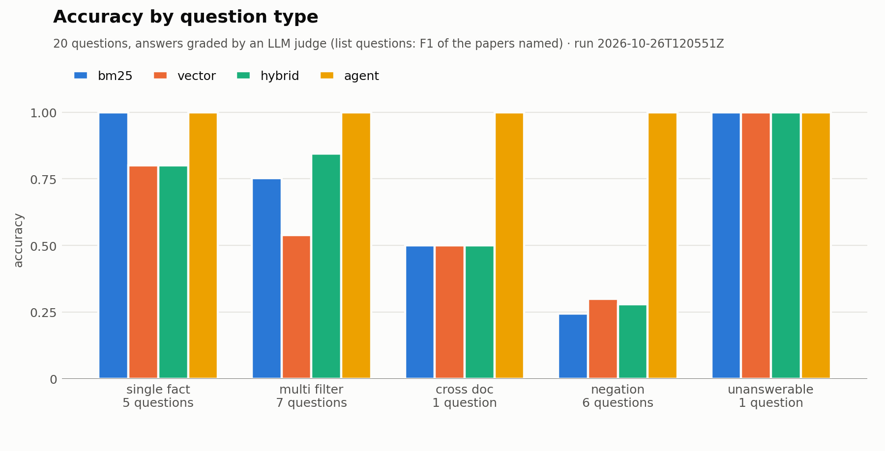

# rag-vs-agent-bench

[](https://github.com/Swayam-Ch/rag-vs-agent-bench/actions/workflows/ci.yml)

Does agentic file search beat vector search? A reproducible benchmark on public data.

> On 20 questions about 20 ML papers, an LLM agent that searches the papers with `grep`
> and `read` answered all 20 correctly (accuracy 1.00). Answers written by the same model
> from retrieved passages scored 0.55 with vector search, 0.65 with hybrid and 0.66 with
> BM25. The agent cost about 4x as much per question and took about 3x as long. Most of
> the gap comes from questions that require checking every paper, such as "which papers
> ..." lists and especially "which papers do NOT ...", where the other methods scored
> 0.24 to 0.30. On single facts, BM25 matched the agent. The sample is small, the papers
> are famous and an LLM drafted most of the questions, so read the
> [limitations](#limitations) before quoting these numbers.

The benchmark compares five ways of answering questions over a document collection:

| Method  | How it finds context |
|---------|----------------------|
| Keyword | count of query words in each chunk (a baseline any real method should beat) |
| BM25    | classic lexical ranking, implemented from scratch |
| Vector  | embed chunks, cosine similarity |
| Hybrid  | BM25 + vector, fused by reciprocal rank |
| Agent   | an LLM with `list_files` / `grep` / `read_file` tools over the raw text |

All of them search the same ingested text and answer the same versioned question set.
Every run's raw output is committed under `results/`.

## Quickstart

```bash
python -m venv .venv && source .venv/bin/activate
pip install -e ".[dev]"            # add ",vector" for vector search (installs PyTorch),
                                   # ",agent" for agentic search (needs ANTHROPIC_API_KEY)
pytest

# download the corpus defined in data/sources.txt (~1 min, rate-limited), then ingest it
ragbench-fetch data/sources.txt data/raw -v
ragbench-fetch data/sources.txt data/raw --verify   # prove you have the exact same PDFs
ragbench-ingest data/raw data/processed -v
ragbench-chunk data/processed                       # -> data/processed/chunks.paragraph.1000.jsonl
ragbench-chunk data/processed --method fixed        # -> chunks.fixed.1000-200.jsonl

# search with any method
ragbench search "how many attention heads does the Transformer use?"            # BM25
ragbench search -m vector -k 3 "dense retrieval for open-domain QA"            # needs [vector]
ragbench search -m hybrid "LoRA rank"
ragbench search -m agent "which papers evaluate on Natural Questions?"          # needs [agent]
ragbench search -m bm25 --json "BM25 baseline" > results.json

# check the question set (also runs in CI)
ragbench questions

# run the benchmark: every method on every question -> results/<UTC time>/
ragbench run                                        # keyword, bm25, vector, hybrid
ragbench run --methods bm25,agent                   # the agent costs money: opt in
ragbench run --methods bm25 --questions q001,q006 -k 5
ragbench run --methods bm25,vector,hybrid,agent --judge   # + graded answers (costs money)
ragbench summarize results/<run>                    # markdown tables for the README
ragbench chart results/<run>                        # accuracy_by_type.png (needs [plot])
```

Each run gets its own folder: `run.json` (config, input checksums, git commit, package
and model versions, a summary per method) plus one `<method>.jsonl` with a row per
question (ranked results with pages, retrieval metrics, timing; for the agent also the
answer, tool calls, tokens and cost). Runs with the same `config_hash` are comparable.

With `--judge`, every method also has to answer the question. The agent's model writes an
answer for each chunk-based method from that method's top-k passages, so the methods
differ only in what they retrieved. An LLM judge (Opus by default, a different model from
the writer) grades each answer against the reference as correct, partial or wrong and
gives a one-line reason. For "which papers" questions, the code scores the F1 of the
papers the answer names against the gold papers, so naming 1 of 10 papers scores lower
than naming 9 of 10. The summary counts answers that say "the papers don't say"
separately from confident wrong answers. Each question records the tokens, time and cost
of answering and judging. `src/ragbench/eval/grade.py` describes the rubric, the known
weaknesses of LLM judges (preference for their own style, for longer answers, for what
they already know) and how the rubric handles them. Read a sample of the judge's reasons
before trusting its verdicts.

## Results

First full run ([`results/2026-10-26T120551Z`](results/2026-10-26T120551Z/summary.md)),
from commit `eb37542`: 4 methods, 20 questions, the top 10 passages per question, and
answers graded by an LLM judge. The agent's model (`claude-sonnet-5-5`) wrote the answers
for the chunk-based methods from their passages. The run's `summary.md` has the full
tables, including accuracy by question type and by question author.



| method | recall@5 | MRR | paper recall | accuracy | cost / q | time / q |
|:---|---:|---:|---:|---:|---:|---:|
| bm25 | 0.61 | 0.58 | 0.88 | 0.66 | $0.012 | 3.9 s |
| vector | 0.48 | 0.49 | 0.87 | 0.55 | $0.011 | 4.2 s |
| hybrid | 0.56 | 0.55 | 0.93 | 0.65 | $0.011 | 3.9 s |
| agent | 0.45 | 0.40 | 1.00 | 1.00 | $0.045 | 11.0 s |

Recall@5 is the share of gold pages in a method's top 5 results, and MRR rewards ranking
the first one high. Paper recall is the share of gold papers found anywhere in what a
method returned. Accuracy gives 1 for correct, 0.5 for partial and 0 for wrong, except on
"which papers" questions, which score the F1 of the papers named. Cost and time are per
question and include writing the answer. Judging the whole run cost another $0.76.

### What the numbers show

1. Top-k retrieval breaks down on questions that require checking every paper. On the 6
   "which papers do NOT ..." questions, BM25, vector and hybrid scored 0.24 to 0.30. Ten
   passages can't show that a paper lacks something, while the agent greps every paper
   and scored 1.00. Question q008, which needs a table from each of two papers, failed
   for the same reason: one search can't fetch both.
2. BM25 is enough for a single fact. It answered all 5 single-fact questions correctly,
   as the agent did, at about a quarter of the cost. Vector and hybrid got 4 of 5.
3. BM25 ranked best and hybrid found the most papers. The questions share exact terms
   with the papers, which BM25 rewards (MRR 0.58 against 0.49 for vector). Hybrid found
   the most gold papers (0.93) but often ranked first a page on the right topic that
   didn't hold the answer.
4. The agent has the lowest rank metrics because it doesn't rank by relevance: its
   results are in the order it searched. Paper recall (1.00) is the retrieval number that
   means something for it. It answered from `grep` snippets alone on 17 of 20 questions
   and opened a paper with `read_file` on only 3.
5. Of the 14 answers that scored 0, 10 said the passages didn't contain the answer and 4
   were confident wrong answers (one or two per chunk-based method). No agent answer
   scored 0.

### Limitations

- The benchmark is small: 20 papers and 20 questions. One question moves accuracy by
  0.05, and two question types (cross_doc and unanswerable) have one question each. Each
  method ran once, and since the agent and the judge aren't deterministic, the variance
  between runs is unknown.
- The papers are famous, and the model has read them. The agent sometimes says it is
  answering from memory (q020: "I did not grep these papers. I'm relying on what I know
  of them"), and the judge counts a correct remembered fact as correct. A fair test needs
  documents the model has never seen, such as internal documents or papers newer than
  its training data.
- An LLM drafted 18 of the 20 questions by grepping the corpus, which is also how the
  agent searches. A person checked each one by hand (`author: llm`). Only 2 questions are
  hand-written, too few for the by-author comparison to show anything yet.
- The judge (`claude-opus-5-5`) is from the same model family as the model that wrote
  every answer. It grades facts against a human reference and every verdict has a reason
  that was spot-checked, but its bias hasn't been measured.
- Everything ran in one configuration: one answering model, one embedding model
  (all-MiniLM-L6-v2), paragraph chunks of 1000 characters and k = 10. A larger embedding
  model, a reranker or more passages could close part of the gap. The agent wasn't tuned
  either.
- Keyword search is missing from the committed run. A later run that included it ran out
  of API credit partway and was discarded. Its retrieval numbers cost nothing to
  reproduce with `ragbench run --methods keyword`.
- Questions q016 and q019 say "(see q006)", which the methods can't see. The agent pointed
  this out and still answered both correctly.

## Reproduce the results

Retrieval metrics (recall, MRR) are deterministic. Answers and verdicts come from LLMs
and can differ a little between runs. A full judged run costs about $2.50 in API usage
(prices checked 2026-10-21) and takes about 10 minutes.

```bash
git clone https://github.com/Swayam-Ch/rag-vs-agent-bench && cd rag-vs-agent-bench
git checkout eb37542            # the commit the committed run was made from
python -m venv .venv && source .venv/bin/activate
pip install -e ".[dev,vector,agent]"

ragbench-fetch data/sources.txt data/raw -v
ragbench-fetch data/sources.txt data/raw --verify   # same PDFs, byte for byte
ragbench-ingest data/raw data/processed -v
ragbench-chunk data/processed                       # paragraph chunks, 1000 characters
ragbench questions                                  # 20 questions OK

export ANTHROPIC_API_KEY=...                        # and ANTHROPIC_WORKSPACE_ID if your
                                                    # key spans several workspaces
ragbench run --methods bm25,vector,hybrid,agent --judge

git checkout main               # the reporting commands came after the run
pip install -e ".[dev,vector,agent,plot]"
ragbench summarize results/<new run>                # compare with the committed summary.md
ragbench chart results/<new run>
```

A run at that commit should have the same `config_hash` in its `run.json` as the
committed run (`0e31feb80e3f`). The hash covers the settings, the models and the
checksums of the question file and the chunks, so a different hash means a different
input. The usual cause is a different version of the PDF-extraction library; the
committed `run.json` lists every package version (pypdf 6.19.0, for example).

## Methodology notes

- Paper metadata lives in `manifest.jsonl`, outside the searchable text, so front-matter tokens neither help nor hurt any method.
- Ingestion cuts the bibliographies and keeps the appendices. Reference lists repeat titles and keywords from across the field and would create false matches for every method. `manifest.jsonl` records how many characters were removed from each paper.
- A line that appears at the top or bottom of at least half the pages (for example *Published as a conference paper at ICLR 2023*) is a running header or footer and is removed, along with page numbers; otherwise it would land in many chunks. Lines in the middle of a page are never touched, and the manifest records `boilerplate_lines_removed`.
- Paragraph breaks come from the line layout, because PDF extractors rarely leave blank lines between paragraphs. A short line that ends a sentence followed by a line that starts a new block, or a section heading, marks a break. Without this rule every page came out as a single paragraph.
- Page offsets are recorded, so an answer can be checked against the page it cites.
- `data/checksums.sha256` records the SHA-256 of every PDF, and a run on different files stops with an error.
- Titles, authors, dates and categories come from the arXiv API once, at download time, and are committed in `data/metadata.jsonl`. Ingestion never uses the network.
- Every search method returns results as positions in the documents (document, character range, pages) and passes the same contract tests: best result first, deterministic ties, no duplicates, and results that match the source text. The agent reports the ranges it read, so the same metrics score it and the chunk-based methods.
- A document's ID is a hash of its bytes, so reruns line up.

## Layout

```
data/sources.txt         # the corpus: 20 arXiv IDs (PDFs themselves are not committed)  ✅
data/checksums.sha256    # SHA-256 of every PDF, checked on each run                     ✅
data/metadata.jsonl      # title, authors, date, category per paper (from the arXiv API) ✅
src/ragbench/
  cli.py                 # `ragbench search --method {keyword,bm25,vector,hybrid,agent}` ✅
  pipeline/fetch.py      # download the PDFs listed in sources.txt                       ✅
  pipeline/checksums.py  # record / verify file hashes                                   ✅
  pipeline/metadata.py   # arXiv API client + metadata snapshot                          ✅
  pipeline/ingest.py     # PDF/txt/md -> clean markdown + manifest                       ✅
  pipeline/chunk.py      # fixed windows or whole paragraphs, page-aware                 ✅
  search/base.py         # SearchResult, Searcher contract, keyword baseline             ✅
  search/bm25.py         # BM25 from scratch, cross-checked against rank_bm25            ✅
  search/vector_search.py # embeddings + cosine similarity, cached on disk               ✅
  search/hybrid_search.py # reciprocal rank fusion of any searchers (BM25 + vector)     ✅
  search/agent_tools.py  # list_files / grep / read_file: safe, bounded, logged          ✅
  search/agent_search.py # tool-calling agent loop: limits, transcripts, token usage     ✅
eval/questions.yaml      # the answer key: 20 questions, gold papers + pages (see below)  ✅
  src/ragbench/eval/questions.py # format + validator (`ragbench questions`)            ✅
  src/ragbench/eval/metrics.py   # recall@k, MRR, page hits (page and paper level)     ✅
  src/ragbench/eval/run.py       # `ragbench run`: every method x question, saved      ✅
  src/ragbench/eval/grade.py     # answers from passages + LLM judge (`--judge`)         ✅
  src/ragbench/eval/summarize.py # `ragbench summarize`: markdown tables from a run      ✅
  src/ragbench/eval/chart.py     # `ragbench chart`: accuracy by question type (PNG)    ✅
results/                 # committed run outputs (agent transcripts stay local)         ✅
tests/
```

Swayam wrote questions q001 and q002. An LLM drafted q003 to q020 from the ingested text,
with a quote and page for each, and Swayam checked them against the PDFs (`author: llm`).
The same model family powers the agent under test, so the questions focus on details
that are hard to know without reading this collection, such as setup details, table
values and counts across papers. Every run reports accuracy by author, so you can see
whether who wrote a question affects the results.

## License

MIT
